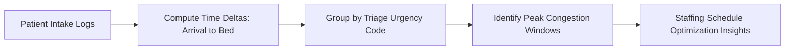

# Hospital Emergency Room Operational Flow Analytics

> Healthcare operations analysis examining patient intake bottlenecks and triage intervals.

[](https://github.com/sohailahmed-bsrh/emergency-room-analysis)
[](https://sohail.devsil.com/projects.html)
[](https://sohail.devsil.com)

---

## Overview

Overcrowding in emergency departments leads to excessive patient wait times, compromised clinical outcomes, and staff fatigue.

This project provides an end-to-end, reproducible implementation engineered to solve this challenge through verified data transformations, robust algorithms, and production-ready architecture.

---

## Key Features

- Patient intake log cleaning and time delta calculation between arrival, triage, and bed assignment
- Peak arrival window identification across days of week and hours of day
- Admission rate correlation across triage acuity levels
- Visual queue duration summaries guiding clinical staffing schedules

---

## System Architecture



---

## Technology Stack

| Technology | Version / Spec | Role in Architecture |
| :--- | :--- | :--- |
| **Python** | `3.10+` | Healthcare analytics and time interval computing |
| **Pandas** | `2.0+` | Date-time slicing and groupby calculations |
| **Matplotlib** | `3.7+` | Queue distribution histograms and boxplots |

---

## Repository Structure

```text
emergency-room-analysis/
|-- notebooks/
|   `-- ER.ipynb
|-- data/
|-- .gitignore
|-- requirements.txt
`-- README.md
```

---

## Installation and Execution

### Prerequisites
- Python 3.10 or higher
- Git version control
- Virtual environment manager (`venv`)

### Setup Instructions
1. Clone the repository:
```bash
git clone https://github.com/sohailahmed-bsrh/emergency-room-analysis.git
cd emergency-room-analysis
```

2. Configure environment and dependencies:
```bash
python -m venv venv
source venv/bin/activate  # On Windows: venv\Scripts\activate
pip install -r requirements.txt
jupyter notebook notebooks/ER.ipynb
```

---

## Interface and Verification
The system produces verifiable execution logs, prediction matrices, or interactive browser interfaces depending on the target mode. Verify operation by executing the commands specified above or inspecting the demonstration notebooks.

---

## Author and Contact
Developed by **Sohail Ahmed** — Full Stack AI Engineer & Machine Learning Specialist.
- **Portfolio:** [sohail.devsil.com](https://sohail.devsil.com)
- **GitHub:** [@sohailahmed-bsrh](https://github.com/sohailahmed-bsrh)
- **Email:** [sohail.bsrh@gmail.com](mailto:sohail.bsrh@gmail.com)
