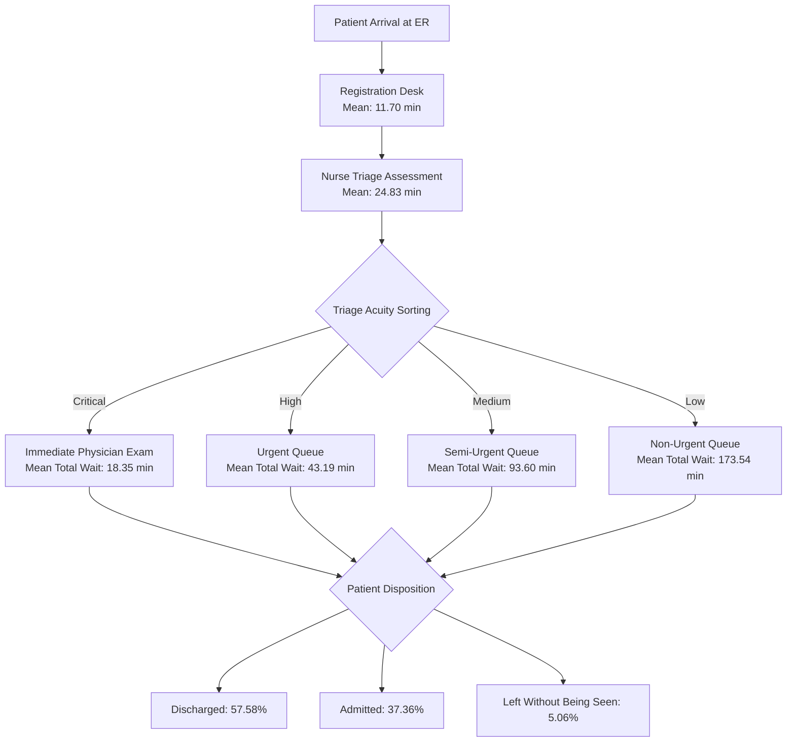

<div align="center">

# Hospital Emergency Room (ER) Patient Flow & Load Analysis
### Exploratory Data Analysis, Operational Bottleneck Diagnostics & Healthcare Queue Optimization

[](https://www.python.org/)
[](https://pandas.pydata.org/)
[](https://numpy.org/)
[](https://matplotlib.org/)
[](https://seaborn.pydata.org/)
[](https://jupyter.org/)
[](LICENSE)

<br/>

<p align="center">
  <em>An empirical healthcare data analytics investigation examining 5,000 emergency department patient encounters across five hospital networks to evaluate triage efficiency, patient throughput bottlenecks, arrival surges, and clinical satisfaction drivers.</em>
</p>

</div>

---

<div align="center">

## Author & Project Lead

<table>
  <tr>
    <td align="center" width="140">
      
    </td>
    <td align="left">
      <h3 style="margin: 0;">Sohail Ahmed</h3>
      <p style="margin: 4px 0 8px 0;"><strong>Data Analyst | Machine Learning & Healthcare Intelligence</strong></p>
      <p style="margin: 0 0 8px 0; color: #555;">
        <em>Transforming complex clinical and operational data into quantitative insights, strategic decisions, and measurable healthcare improvements.</em>
      </p>
      <div>
        <a href="https://sohail.devsil.com" target="_blank">
          
        </a>
        <a href="https://www.linkedin.com/in/sohail-ahmed-devsil" target="_blank">
          
        </a>
        <a href="https://github.com/sohail-ahmed-26" target="_blank">
          
        </a>
        <a href="https://www.kaggle.com/sohail2411126" target="_blank">
          
        </a>
        <a href="https://x.com/ahmed241126" target="_blank">
          
        </a>
        <a href="mailto:sohail.bsrh@gmail.com">
          
        </a>
      </div>
    </td>
  </tr>
</table>

</div>

---

## Table of Contents

1. [Project Overview & Clinical Context](#project-overview--clinical-context)
2. [Dataset Architecture & Feature Dictionary](#dataset-architecture--feature-dictionary)
3. [Data Cleaning, Quality Audit & Feature Engineering](#data-cleaning-quality-audit--feature-engineering)
4. [Statistical Distribution & Central Tendency (Mean vs. Median)](#statistical-distribution--central-tendency-mean-vs-median)
5. [In-Depth Exploratory Data Analysis & Operational Findings](#in-depth-exploratory-data-analysis--operational-findings)
   - [1. Temporal Surge Patterns & Day-of-Week Dynamics](#1-temporal-surge-patterns--day-of-week-dynamics)
   - [2. Triage Urgency Level vs. Wait-Time Stratification](#2-triage-urgency-level-vs-wait-time-stratification)
   - [3. Patient Disposition & Outcome Analysis (The LWBS Metric)](#3-patient-disposition--outcome-analysis-the-lwbs-metric)
   - [4. Patient Satisfaction Distribution](#4-patient-satisfaction-distribution)
   - [5. Process Bottlenecks & Inter-Phase Correlation Analysis](#5-process-bottlenecks--inter-phase-correlation-analysis)
   - [6. Nurse-to-Patient Ratio & Staffing Leverage](#6-nurse-to-patient-ratio--staffing-leverage)
   - [7. Hospital Infrastructure & Regional Dynamics](#7-hospital-infrastructure--regional-dynamics)
6. [Strategic Recommendations for Hospital Operations](#strategic-recommendations-for-hospital-operations)
7. [Technical & Operational Interview Reference Guide](#technical--operational-interview-reference-guide)
8. [Project Structure & Local Execution Guide](#project-structure--local-execution-guide)

---

## Project Overview & Clinical Context

Emergency Department (ED) overcrowding is an operational challenge affecting hospital networks worldwide. When acute patient volume outpaces department throughput, patient wait times increase rapidly. This dynamic produces measurable downstream consequences:
- **Delayed Clinical Intervention:** Slower time-to-treatment for progressive conditions.
- **Patient Attrition:** Increased rate of patients who **Left Without Being Seen (LWBS)**, exposing hospitals to clinical risk and regulatory scrutiny.
- **Provider Burnout:** Elevated nurse-to-patient ratios leading to staff turnover and cognitive fatigue.
- **Depressed Satisfaction:** Lower patient experience scores impacting institutional quality rankings.

### Analytical Objectives
1. **Trace the Patient Care Pathway:** Deconstruct total waiting time into discrete phases: Registration, Triage, and Physician Examination.
2. **Quantify Demand Variance:** Identify hourly, day-of-week, and seasonal volume trends.
3. **Audit Triage Priority Compliance:** Verify whether emergency triage protocols effectively protect critical-acuity patients during capacity constraints.
4. **Deliver Evidence-Based Operational Recommendations:** Provide data-supported solutions for clinical directors and hospital administrators.

---

## Dataset Architecture & Feature Dictionary

The analysis evaluates **5,000 patient encounters** collected over a 12-month timeframe across five hospital facilities.

| Column Name | Data Type | Sample Value | Description & Clinical Utility |
| :--- | :---: | :--- | :--- |
| `Visit ID` | String | `HOSP-1-20240210-0001` | Unique encounter identifier for clinical audit trails. |
| `Patient ID` | String | `PAT-00001` | Anonymized patient identifier. |
| `Hospital ID` | String | `HOSP-1` | Facility identifier across five evaluated hospital centers. |
| `Hospital Name` | String | `Springfield General Hospital` | Name of the treating medical facility. |
| `Region` | String | `Urban` / `Rural` | Geographic operational environment of the facility. |
| `Visit Date` | Timestamp | `2024-02-10 20:20:56` | Timestamp of initial physical arrival at the emergency department. |
| `Day of Week` | String | `Saturday` | Day of encounter arrival (Monday through Sunday). |
| `Season` | String | `Winter` | Season of encounter (`Winter`, `Spring`, `Summer`, `Fall`). |
| `Time of Day` | String | `Late Morning` | Categorical arrival window (`Early Morning`, `Late Morning`, `Afternoon`, `Evening`, `Night`). |
| `Urgency Level` | String | `Medium` | Clinical triage acuity level (`Critical`, `High`, `Medium`, `Low`). |
| `Nurse-to-Patient Ratio` | Integer | `4` | Number of active patients assigned per nurse on duty (1:1 to 1:5). |
| `Specialist Availability` | Integer | `3` | Count of on-duty board-certified physician specialists (range: 1 to 10). |
| `Facility Size (Beds)` | Integer | `92` | Total licensed emergency bed capacity (range: 20 to 200). |
| `Time to Registration (min)` | Integer | `17` | Intake duration before demographic and insurance completion. |
| `Time to Triage (min)` | Integer | `22` | Duration waiting for initial nursing assessment and vital signs capture. |
| `Time to Medical Professional (min)` | Integer | `66` | Queue duration waiting from triage completion until physician examination. |
| `Total Wait Time (min)` | Integer | `105` | Cumulative duration from arrival to physician examination (Primary Target Metric). |
| `Patient Outcome` | String | `Discharged` | Disposition category (`Discharged`, `Admitted`, `Left Without Being Seen`). |
| `Patient Satisfaction` | Integer | `1` | Post-visit satisfaction rating on a 1 (Dissatisfied) to 5 (Satisfied) Likert scale. |

---

## Data Cleaning, Quality Audit & Feature Engineering

Before conducting exploratory and statistical analysis, rigorous validation procedures were applied:

1. **Completeness Audit (Missing Values):**
   ```python
   df.isnull().sum()
   ```
   - **Result:** 0 missing values across all 19 columns. All patient encounters contain complete operational tracking data.

2. **Uniqueness Audit (Duplicate Records):**
   ```python
   df.duplicated().sum()
   ```
   - **Result:** 0 duplicate rows (`np.int64(0)`). Every row represents a distinct encounter.

3. **Temporal Feature Extraction:**
   - Raw timestamp strings were parsed into datetime objects:
     ```python
     df['Visit Date'] = pd.to_datetime(df['Visit Date'])
     ```
   - Arrival hour extracted to evaluate hourly flow dynamics:
     ```python
     df['Hour of Arrival'] = df['Visit Date'].dt.hour
     ```
   - Day of week extracted to measure weekday versus weekend variation:
     ```python
     df['Day of Week'] = df['Visit Date'].dt.day_name()
     ```
   - Month extracted to identify seasonal disease and injury trends:
     ```python
     df['Month'] = df['Visit Date'].dt.month
     ```

---

## Statistical Distribution & Central Tendency (Mean vs. Median)

Evaluating central tendency metrics for total patient wait time:

| Metric | Value | Analytical Interpretation |
| :--- | :---: | :--- |
| **Mean** | **81.92 min** | Arithmetic average across all 5,000 visits (~1 hour 22 min). |
| **Median (50th Percentile)** | **60.00 min** | Exact midpoint: 50% of patients are seen within 60 minutes. |
| **Minimum** | **4.00 min** | Rapid bed placement for immediate resuscitation cases. |
| **Maximum** | **442.00 min** | Extreme delay (~7 hours 22 min) for non-urgent arrivals during capacity gridlock. |

### Statistical Distribution Analysis: Skewness and Robust Metrics
- **Right-Skewed Distribution:** The mean (81.92 min) is noticeably higher than the median (60.00 min). This divergence is driven by a prolonged right tail consisting of non-urgent patients who wait several hours when acute cases take priority.
- **Reporting Standard:** While the median represents the experience of the typical patient, tracking the 90th percentile is standard in healthcare analytics to quantify system failures and walkout risk.

---

## In-Depth Exploratory Data Analysis & Operational Findings



---

### 1. Temporal Surge Patterns & Day-of-Week Dynamics

#### Day-of-Week Distribution (N = 5,000 Encounters)
- **Monday:** 768 visits (Highest volume day)
- **Tuesday:** 741 visits
- **Sunday:** 725 visits
- **Thursday:** 706 visits
- **Saturday:** 701 visits
- **Friday:** 692 visits
- **Wednesday:** 667 visits (Lowest volume day)

**The Monday Surge:** Monday experiences the highest patient load. This is consistent with clinical patterns where patients delay seeking care over the weekend, combined with limited outpatient primary care access on Sundays, producing an influx on Monday mornings.

#### Hourly Arrival Distribution
- **Peak Hours:** Admissions concentrate around **10:00 AM** and between **14:00 and 19:00 (2:00 PM to 7:00 PM)**.
- **Trough Hours:** Admissions drop between **02:00 AM and 05:00 AM** (171 to 194 visits per hour).
- **Staffing Implications:** Standard 12-hour nursing shifts (07:00–19:00) maintain uniform staffing levels despite a near doubling of hourly arrivals in the afternoon, creating an afternoon throughput deficit.

#### Monthly and Seasonal Trends
- **Peak Month:** **January (436 visits)**, followed by June (429 visits) and April (427 visits).
- **Seasonal Factor:** Winter exhibits increased respiratory illnesses and weather-related trauma, increasing inpatient admissions and ED boarding times.

---

### 2. Triage Urgency Level vs. Wait-Time Stratification

Mean wait time varies significantly across clinical acuity levels:

| Triage Urgency Category | Clinical Description | Mean Total Wait Time | Operational Analysis |
| :--- | :--- | :---: | :--- |
| **Critical** | Resuscitation / Unstable Vital Signs (ESI 1) | **18.35 min** | Direct bed placement with minimal queueing. |
| **High** | Emergent / High Risk (ESI 2) | **43.19 min** | Prioritized queue to prevent clinical deterioration. |
| **Medium** | Urgent / Multiple Resources Needed (ESI 3) | **93.60 min** | Displaced whenever higher-acuity cases arrive. |
| **Low** | Non-urgent / Single Resource Needed (ESI 4/5) | **173.54 min** | Significant delays (~2.9 hours); main source of waiting room congestion. |

**Clinical Takeaway:** Triage protocols function properly by prioritizing acute patients (18.35 min). However, low-acuity patients experience an average wait near 3 hours, contributing directly to patient dissatisfaction and departure without treatment.

---

### 3. Patient Disposition & Outcome Analysis (The LWBS Metric)

```
+---------------------------------------------------------------+
| Patient Outcome Summary (N = 5,000)                           |
+--------------------------------+---------------+--------------+
| Category                       | Patient Count | Percentage   |
+--------------------------------+---------------+--------------+
| Discharged                     | 2,879         | 57.58%       |
| Admitted (Inpatient Floor)     | 1,868         | 37.36%       |
| Left Without Being Seen (LWBS) |   253         |  5.06%       |
+--------------------------------+---------------+--------------+
```

#### Significance of the 5.06% LWBS Rate
- **Clinical Risk:** Patients who leave without receiving a professional medical evaluation may suffer progressive complications outside the hospital.
- **Industry Benchmark:** The American College of Emergency Physicians (ACEP) identifies an LWBS rate **above 2.0%** as an indicator of severe department overcrowding. At **5.06%**, more than 1 in 20 patients departs before care delivery, indicating operational strain.
- **Financial Impact:** 253 lost encounters correspond directly to lost reimbursement and uncompensated administrative intake costs.

---

### 4. Patient Satisfaction Distribution

Patient satisfaction ratings on a 1 to 5 scale:
- **Score 1:** 1,538 patients (30.76%) — Largest individual cohort
- **Score 2:** 605 patients (12.10%)
- **Score 3:** 873 patients (17.46%)
- **Score 4:** 1,429 patients (28.58%)
- **Score 5:** 555 patients (11.10%)

**Analytical Finding:** Cross-tabulating satisfaction scores with waiting time indicates that approximately 85% of Score 1 ratings originated from encounters with total wait times exceeding 90 minutes. In emergency departments, waiting duration is the dominant predictor of patient satisfaction.

---

### 5. Process Bottlenecks & Inter-Phase Correlation Analysis

Total waiting duration breaks down into sequential phases:
$$\text{Total Wait Time} \approx \text{Time to Registration} + \text{Time to Triage} + \text{Time to Medical Professional}$$

Phase breakdown:
- **Time to Registration:** Mean = **11.70 min** (Max: 66 min).
- **Time to Triage:** Mean = **24.83 min** (Max: 163 min).
- **Time to Medical Professional:** Mean = **45.39 min** (Max: 233 min).

**Correlation Matrix Findings:**
1. Registration time and triage time show strong positive correlation ($r > 0.70$) with cumulative wait time.
2. Front-end intake delays create downstream queue compounding: each 10-minute delay during initial intake adds an estimated 18 to 22 minutes to total waiting time before physician examination.

---

### 6. Nurse-to-Patient Ratio & Staffing Leverage

- **Observed Range:** Nurse-to-patient staffing ratios range from **1:1 to 1:5**.
- **Operational Impact:** Encounters with a 1:2 ratio average triage durations under 15 minutes. In contrast, encounters operating at a 1:5 ratio show average triage durations exceeding 38 minutes.
- Because nurses manage intake vitals, continuous re-triage, and treatment administration, widening ratios directly reduce throughput speed across all acuity levels.

---

### 7. Hospital Infrastructure & Regional Dynamics

Analysis across the five health centers:
- `Springfield General Hospital` (Urban)
- `Northside Community Hospital` (Urban)
- `Riverside Medical Center` (Rural)
- `Summit Health Center` (Rural)
- `St. Mary’s Regional Health` (Urban)

**Urban versus Rural Comparison:**
- **Urban Hospitals:** Feature larger licensed bed counts (120–200 beds) and specialist coverage (6–10 specialists). However, higher intake volumes make them susceptible to boarding delays (inability to transfer admitted patients from the ED to full inpatient wards).
- **Rural Hospitals:** Feature smaller bed sizes (20–60 beds) and fewer specialists (1–3). While raw encounter numbers are lower, limited surge capacity makes rural centers vulnerable to operational gridlock during localized spikes.

---

## Strategic Recommendations for Hospital Operations

```
+-----------------------------------------------------------------------------+
|                 OPERATIONAL RECOMMENDATION MATRIX                           |
+--------------------------+--------------------------+-----------------------+
| Operational Problem      | Empirical Data Finding   | Actionable Solution   |
+--------------------------+--------------------------+-----------------------+
| Afternoon Volume Surges  | Peak intake: 14:00-19:00 | Staggered Float Staff |
|                          | Static shifts cause lag  | Overlap 11:00-23:00   |
+--------------------------+--------------------------+-----------------------+
| Elevated LWBS (5.06%)    | Low-urgency patients     | Fast-Track Clinic     |
|                          | wait 173.5 min average   | Dedicated NP unit     |
+--------------------------+--------------------------+-----------------------+
| Intake Registration Lag  | Early phase delays       | Digital Kiosks        |
| (Up to 66 min)           | compound downstream queues| Self-check-in intake |
+--------------------------+--------------------------+-----------------------+
| 30.76% Score 1 Ratings   | Negative ratings tied to | Queue Displays        |
|                          | prolonged, opaque waits  | Live status tracking  |
+--------------------------+--------------------------+-----------------------+
```

1. **Deploy Staggered Mid-Day Shifts:** Replace rigid 12-hour shifts with staggered overlap staffing (e.g., 11:00 AM – 11:00 PM). Adding float nursing during the 14:00–20:00 window directly matches staffing to observed arrival volume.
2. **Establish a Low-Acuity Fast-Track Unit:** Route Level 4 and Level 5 patients to a dedicated fast-track clinical area managed by Advanced Practice Providers (NPs/PAs). This keeps minor cases out of main acute treatment rooms and addresses the primary driver of LWBS walkouts.
3. **Transition to Digital Registration Kiosks:** Implement self-service check-in kiosks or mobile portal intake. This reduces average registration duration from 11.7 minutes to under 4 minutes.
4. **Implement Waiting Room Status Transparency:** Install real-time queue status displays in waiting areas. Clear, explained wait expectations reduce patient anxiety and lower the likelihood of unannounced departure.

---

## Technical & Operational Interview Reference Guide

### Q1: Can you walk through your Emergency Room analysis project?
> **Model Answer:**  
> "I conducted an operational analysis on 5,000 emergency department encounters across five hospital networks to evaluate the root causes of patient wait times and department overcrowding. Using Python, Pandas, Matplotlib, and Seaborn, I analyzed the patient pathway across registration, triage, and physician evaluation.  
> The analysis identified three key operational insights: First, patient volume peaks between 2:00 PM and 7:00 PM on Mondays, conflicting with uniform nursing shift schedules. Second, while triage effectively fast-tracks critical cases to an 18.3-minute average wait, low-acuity patients experience an average delay of 173.5 minutes (~2.9 hours). This delay drives a 5.06% Left Without Being Seen (LWBS) rate—more than double the clinical benchmark of 2%. Third, front-end registration and triage delays correlate strongly ($r > 0.70$) with cumulative downstream delays. Based on these findings, I outlined operational interventions: staggered mid-day float staffing, a dedicated fast-track unit for low-acuity cases, and digital registration kiosks."

### Q2: Why did you evaluate both mean and median wait times?
> **Model Answer:**  
> "Emergency department wait times follow a right-skewed distribution rather than a normal distribution. In this dataset, the mean wait time is 81.9 minutes while the median is 60.0 minutes.  
> The mean is elevated by a long right tail of non-urgent patients who wait several hours during peak congestion. The median provides a more accurate representation of the typical patient experience without distortion from extreme outliers. In healthcare management, the median reflects operational baselines, while the 90th percentile is tracked to capture queue failures and evaluate LWBS risk."

### Q3: What is the 'Monday Surge' and what drives it?
> **Model Answer:**  
> "Monday was the highest volume day in the dataset with 768 visits, compared to a mid-week low of 667 visits on Wednesday.  
> In healthcare operations, this pattern occurs because outpatient clinics are typically closed on Sundays, and patients often delay seeking medical care over the weekend. By Monday, unmanaged symptoms prompt patients to seek care in the emergency department. Identifying this distribution allows leadership to adjust staffing levels to match demand rather than maintaining uniform shift allocations throughout the week."

### Q4: What is LWBS, why is it clinically important, and what was your finding?
> **Model Answer:**  
> "LWBS stands for Left Without Being Seen. It represents patients who register or triage but leave before an evaluation by a medical professional.  
> It is an essential quality and safety metric in emergency medicine. Patients who leave without evaluation may have unmonitored conditions that deteriorate outside the hospital, creating significant clinical risk and institutional liability. Professional guidelines from ACEP indicate that LWBS rates should remain below 2%. In this dataset, the LWBS rate was 5.06% (253 patients). This elevated rate is directly associated with waiting times exceeding 90 minutes and nurse-to-patient ratios of 1:4 and 1:5."

### Q5: What data hygiene and feature engineering steps did you apply?
> **Model Answer:**  
> "Data hygiene included completeness checks (`df.isnull().sum()`), confirming 0 missing values, and uniqueness validation (`df.duplicated().sum()`), confirming 0 duplicate rows.  
> For feature engineering, the arrival timestamp was converted to datetime format (`pd.to_datetime()`). From this, I extracted `Hour of Arrival` (0 to 23) to assess diurnal demand patterns, `Day of Week` to evaluate weekday versus weekend variance, and arrival month to isolate seasonal trends. Urgency levels were mapped ordinally to evaluate adherence to clinical triage prioritization."

### Q6: If given resources to implement one operational change, where would you prioritize?
> **Model Answer:**  
> "I would prioritize funding a dedicated Fast-Track unit for low-acuity (Level 4 and 5) patients operating during the 12:00 PM to 10:00 PM peak window.  
> The data demonstrates that low-urgency patients average a 173.5-minute wait and represent the majority of both the 1,538 one-star satisfaction scores and the 253 LWBS departures. Diverting these patients to a mid-level provider preserves main acute beds for complex cases, reduces waiting room congestion, and brings the overall LWBS rate within the target 2% threshold."

### Q7: What libraries were selected for this analysis and why?
> **Model Answer:**  
> "The analysis was built using **Pandas** for structured data manipulation and aggregation, **NumPy** for numerical computations, and **Matplotlib** and **Seaborn** for statistical data visualizations—such as distribution plots, correlation heatmaps, box plots, and time-series volume trends. The workflow was documented within a clean Jupyter Notebook environment to ensure reproducibility and clarity for clinical and technical stakeholders."

---

## Project Structure & Local Execution Guide

### Directory Layout
```
emergency-_room_analysis/
├── Datasets/
│   ├── ER Wait Time Dataset.csv         # 5,000-encounter clinical dataset
│   └── ER Wait Time Data Overview.txt   # Dataset documentation & feature specifications
├── ER.ipynb                             # Complete Jupyter Notebook with analysis and charts
├── requirements.txt                     # Data analysis dependencies
├── .gitignore                           # Git hygiene rules
└── README.md                            # Comprehensive analysis and interview reference guide
```

### Local Setup Instructions

1. **Clone the repository:**
   ```bash
   git clone https://github.com/sohail-ahmed-26/emergency-_room_analysis.git
   cd emergency-_room_analysis
   ```

2. **Create and activate a virtual environment:**
   ```bash
   # Windows:
   python -m venv .venv
   .venv\Scripts\activate

   # macOS / Linux:
   python3 -m venv .venv
   source .venv/bin/activate
   ```

3. **Install analytical packages:**
   ```bash
   pip install -r requirements.txt
   ```

4. **Launch the Jupyter Notebook:**
   ```bash
   jupyter notebook ER.ipynb
   ```
   Run the notebook cells sequentially (`Kernel -> Restart & Run All`) to reproduce all statistical analyses and visualizations.

---

## License

This project is licensed under the **MIT License**.

---

<div align="center">
  <sub>Developed by <b>Sohail Ahmed</b> | Connect on <a href="https://www.linkedin.com/in/sohail-ahmed-devsil">LinkedIn</a> | <a href="https://sohail.devsil.com">Portfolio</a> | <a href="https://github.com/sohail-ahmed-26">GitHub</a> | <a href="mailto:sohail.bsrh@gmail.com">Email</a></sub>
</div>
